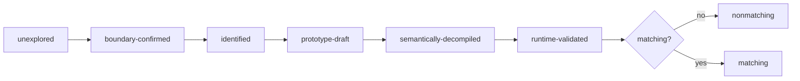

# Matching decompilation and build/diff workflow

## Milestones



Keep runtime validation, byte matching and semantic names/types as separate gates.

## PS1 decompilation stack

| Tool | Role |
|---|---|
| splat | split PSX binaries/sections/code/data; emit project config |
| spimdisasm | MIPS disassembly + symbol-aware analysis |
| maspsx | emulate PsyQ assembler behavior for matching builds |
| mips2c / m2c | initial C hypothesis |
| asm-differ | instruction-level comparison during iteration |
| objdiff | object/function comparison + progress tracking |
| decomp-permuter | explore equivalent C transformations |
| decomp.me | isolated scratch/matching experiments |

Combine tool evidence; do not rely on one decompiler.

## Compiler identification

Before tuning C:

| Pin | Evidence |
|---|---|
| PsyQ/runtime library version; GCC/CC1 version + flags; assembler/preprocessor behavior; optimization level; small-data/GP options; signed-char + ABI details; source language extensions; linker ordering/alignment | library signatures; startup code; generated idioms; object metadata; debug strings; project/toolchain history; controlled compilation experiments |

## Repository structure

| Path | Role |
|---|---|
| `config/targets/` | per-target identity, layout, symbols, image, load address |
| `include/memory/` | generic PS1 memory/accessor headers |
| `include/bof3/` | shared + target-private declarations |
| `src/bof3/<domain>/` | metadata-owned executable + EMI lifts |
| `src/bof3/support/` | target-qualified support + generated bindings |
| `src/shared/<domain>/` | cross-target embedded templates |
| `build/` | generated objects/binaries |
| `out/` | disposable snapshots, index, matching workspaces |

Before source work, read [target ownership](../../bof3-re/references/target-contract.md)
and [matching protocol](../../bof3-re/references/match-loop.md). Use manifest claims
for identity, never filenames or user documentation as runtime contracts.

## Function iteration

1. Extract exact original bytes/instructions.
2. Confirm boundaries/relocations.
3. Draft semantic C.
4. Compile with pinned toolchain.
5. Compare instructions/relocations.
6. Diagnose control flow, expression ordering, register allocation, stack layout, delay slots.
7. Apply one intentional change at a time.
8. Preserve readability unless a matching idiom is proven necessary.
9. Record score/first differing instruction.
10. Validate runtime behavior when integration is possible.

## Common mismatch causes

Signature/signedness · source expression order · temporary lifetime · switch lowering form · loop shape (`for`/`while`/`do`) · constant type/width · struct field type/alignment · inlining/macros · compiler version/flags · assembler macro expansion · section/order/relocation mismatch · data symbol alignment.

## Build comparison

Use harness comparisons; `bin/build-diff` is not wired:

```bash
bin/harness lift asm-diff TARGET@0xADDRESS        # instruction-level diff of one authored lift
bin/harness lift byte-match TARGET@0xADDRESS      # raw byte-equality acceptance check
bin/harness lift permute TARGET@0xADDRESS        # source-shape search
bin/harness lift status TARGET             # exact/partial/invalid lift audit
```

Outside this repo, a `build-diff`-style wrapper can read build settings from environment variables:

```bash
PSX_BUILD_CMD='ninja -C build' \
PSX_EXPECTED=expected/SLUS.bin \
PSX_ACTUAL=build/SLUS.bin \
build-diff
```

Record SHA-256/byte differences; prefer `bin/harness lift asm-diff`/`bin/harness lift byte-match` for covered comparisons.

## Reproducibility

Pin tools in lockfiles/containers where possible. Retain compiler/assembler hashes, commands, environment, generated linker scripts/maps, original/rebuilt object hashes and diffs. Do not publish copyrighted binaries/large slices for CI.
